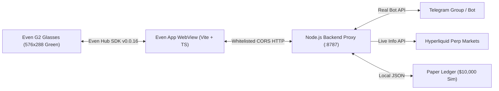

# GlanceDesk for Even G2


**Read VIP Telegram alerts, inspect live 24h Hyperliquid pixel sparklines, reply in 1 tap or by voice, and open/close live-priced paper perps — directly from your Even G2 smart glasses.**

Built for **Heads Up: Even Realities Hackathon (Nov 23 – Nov 29, 2026)**.

- **Tracks Entered (2 + Special Prize):**
  - **Track 01 · Messaging & News:** Telegram Bot API (real live group read & write + `/price`, `/alert`, `/pnl`, `/close` slash commands)
  - **Track 02 · Crypto & DeFi:** Hyperliquid API (real live perpetual mark prices, 24h `candleSnapshot` pixel sparkline via `updateImageRawData`, funding rates + safe paper-trading ledger)
  - **Special Prize:** Best Telegram Integration

---

## Why GlanceDesk Works on G2 ("Read and Write at a Glance")
1. **Glance (Read):** When a message lands in your VIP Telegram chat (e.g. `"SOL breakout, funding flipped!"`), GlanceDesk renders a crisp 3-line summary on the 576 × 288 monochrome green display and automatically pairs it with live Hyperliquid `SOL-PERP` mark price, 24h change, and hourly funding.
2. **Act on Telegram (Write):**
   - **Single tap -> Swipe -> Single tap** sends a contextual smart reply with the live Hyperliquid price directly back into the real Telegram chat.
   - **Long press (Temple / R1 Ring)** captures raw PCM audio from the Even G2 microphone (`bridge.audioControl(true, AudioInputSource.Glasses)`), sends it to the backend proxy, and posts a voice reply into Telegram.
3. **Act on Hyperliquid (Write — Safe Paper Only):**
   - **Single tap -> Flip LONG/SHORT -> Single tap** executes a simulated `$100 / $250 / $500` paper perp position at the live Hyperliquid mark price, updates live mark-to-market PnL on G2, and posts a formatted `[GlanceDesk G2 · HYPERLIQUID PAPER]` receipt back into Telegram.

---

## Architecture


### Even Hub Hardware & QA Compliance
- **Exact 576 × 288 layout validated by official SDK (`validateEvenHubPageContainer`):** 3 text zones (`hdr`, `main`, `act`) + `192 × 140` 4-bit pixel sparkline (`imageObject` via `updateImageRawData`) + native `menuObject` contextual menu (`Feed`, `Paper Order`, `Portfolio`, `Refresh Live`).
- **Official 0..4 Text Brightness Hierarchy:** `textColor: 4` on primary headers/prices and `textColor: 2` on subtle gesture hints.
- **Flicker-free updates:** `createStartUpPageContainer` once at boot, `textContainerUpgrade` for live mark/message updates, sequential `updateImageRawData` pacing, `rebuildPageContainer` only on view switches.
- **SDK Quirk Safe:** Handles both `OsEventTypeList.CLICK_EVENT` (`0`) and `undefined` normalization, plus `sysEvent` long-press pairs.
- **Store QA Root Exit:** Double-tap on the root `FEED` screen calls `shutDownPageContainer(1)` (mandatory native exit confirmation dialog).
- **Zero Secrets in WebView:** Telegram Bot Token stays strictly in server-side `.env`; WebView only talks to the whitelisted CORS backend origin declared in `app.json`.

---

## Quick Start (Reproducible Setup)

**Requirements:** Node.js `>= 20` and a free Telegram bot token from `@BotFather`.

```bash
# 1. Install local dependencies (zero global installs required)
npm install

# 2. Configure local secrets (never committed)
cp .env.example .env
# Edit .env and paste your TELEGRAM_BOT_TOKEN

# 3. Run automated verification tests
npm test

# 4. Start backend proxy (terminal 1)
npm run server

# 5. Start glasses WebView app (terminal 2)
npm run dev

# 6. Launch inside official Even Hub Simulator (terminal 3)
npm run sim
```

*(Optional: build production bundle and `.ehpk` package)*
```bash
npm run build
npm run pack:ehpk
```

Send 1 message in your Telegram group where the bot is admin; GlanceDesk automatically discovers `chat_id` and streams live Telegram + Hyperliquid data.

---

## Money Safety & Prior Work Disclosure
- **Paper Trading Only:** GlanceDesk starts with a simulated `$10,000` paper balance. It never holds user funds, never signs real on-chain orders, and provides no financial advice.
- **Built During Hackathon:** All source code in this repository was written from scratch starting November 23, 2026 during the official build window, using Vite, TypeScript, and `@evenrealities/even_hub_sdk`.

---

## 5 API Feature Requests (For Even Realities, Telegram & Hyperliquid Teams)
1. **Even Hub SDK — Optional Phone-Side Speech-to-Text Helper:** Streaming raw PCM (`audioEvent.audioPcm`) to an external Whisper server adds 1–2s latency and infrastructure overhead. A native phone-side STT helper exposed on `EvenAppBridge` would enable instant hands-free replies.
2. **Even Hub SDK — Preserve Explicit `0` on `CLICK_EVENT`:** `OsEventTypeList.CLICK_EVENT` (`0`) can deserialize as `undefined`, forcing every plugin to guard `case undefined`. Preserving `0` prevents silent tap regressions.
3. **Even Hub Simulator — Mock PCM Audio Fixture Flag:** A `--mock-audio sample.pcm` flag on `@evenrealities/evenhub-simulator` would make end-to-end G2 voice workflows CI-testable without physical glasses.
4. **Telegram Bot API — Scoped Group Context Read on Opt-In:** Bots currently only receive updates arriving *after* polling begins. A scoped opt-in recent-history endpoint for personal assistant bots would eliminate cold-start blank screens on wearables.
5. **Hyperliquid Info API — Compact Multi-Ticker Subscription Payload:** `metaAndAssetCtxs` returns all 150+ perp contracts in one payload. A lightweight `{ type: "assetCtxs", coins: ["BTC", "ETH", "SOL"] }` filter would cut wearable proxy bandwidth by >95%.
