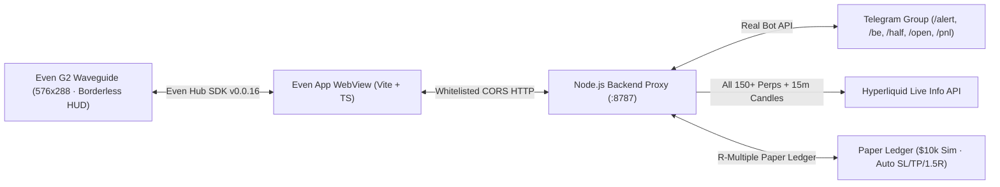

# GlanceDesk for Even G2


**A borderless, glance-first trading HUD for Even G2 smart glasses — manage open perp positions (1-tap Move Stop to Break-Even at 1.5R, 50% partial, close) and react to price structure alerts with live Hyperliquid 15m charts & Telegram sync.**

Built for **Heads Up: Even Realities Hackathon (Nov 23 – Nov 29, 2026)**.

- **Tracks Entered (2 + Special Prize):**
  - **Track 01 · Messaging & News:** Telegram Bot API (arm alerts via `/alert NEAR 4.20`, receive clean execution/BE logs, reply in 1 tap or by G2 voice)
  - **Track 02 · Crypto & DeFi:** Hyperliquid API (all 150+ live perps, live 15m `candleSnapshot` borderless structure curve via `updateImageRawData`, safe paper-only R-multiple ledger with auto SL/2R TP)
  - **Special Prize:** Best Telegram Integration

---

## Real Everyday Even G2 Moments
1. **In a Lecture or Meeting (+1.5R Break-Even in 1 Tap):** You opened a `SOL SHORT` earlier. Live price moves `+1.52R` in your favor. Your glasses quietly surface a borderless HUD (`SOL SHORT +1.52R`) over transparent glass. One tap on the temple/ring moves your stop to **Break-Even (`$72.40`)** — or takes **50% profit** — and logs it to Telegram without ever touching your phone.
2. **Waiting for Structure Break (Alert → Chart → 1-Tap Short/Long):** Before leaving home, you type `/alert NEAR 4.20 structure break` in Telegram. When `NEAR` crosses `$4.20`, your glasses show the live borderless 15m curve breaking the dotted alert line. One tap enters a simulated `$250` paper Short with automatic `SL (+1.5%)` and `TP (2R)` and posts the receipt to Telegram.
3. **Hands-Free Telegram Replies:** Swipe VIP group messages paired with live perp marks, send a 1-tap natural reply, or long-press the temple/R1 ring to capture raw G2 mic PCM (`AudioInputSource.Glasses`) and send a voice reply.

---

## Architecture & Even G2 Optical Craft


- **Designed for Transparent Waveguide Optics:** `borderWidth: 0` across all zones so ~80% of the 576×288 lens stays pure black (= 100% transparent real-world view). No boxed dashboard clutter.
- **Official SDK Validated (`validateEvenHubPageContainer`):** 3 borderless text zones (`textColor: 4` primary / `textColor: 1` whisper metadata) + `186 × 126` borderless 15m structure curve (`imageObject` + sequential `updateImageRawData`) + native G2 contextual menu (`menuObject`).
- **Flicker-Free & QA Compliant:** `createStartUpPageContainer` once at boot, `textContainerUpgrade` for live mark/R refreshes, `CLICK_EVENT (0 -> undefined)` handling, mandatory root `shutDownPageContainer(1)` exit dialog, zero secrets in WebView.

---

## Quick Start (Reproducible Setup)

**Requirements:** Node.js `>= 20` and a free Telegram bot token from `@BotFather`.

```bash
# 1. Install local dependencies (zero global installs required)
npm install

# 2. Configure local secrets (never committed)
cp .env.example .env
# Edit .env and paste your TELEGRAM_BOT_TOKEN

# 3. Run automated verification & official SDK validation tests
npm test

# 4. Start backend proxy (terminal 1)
npm run server

# 5. Start glasses WebView app (terminal 2)
npm run dev

# 6. Launch inside official Even Hub Simulator (terminal 3)
npm run sim
```

*(Build & package `.ehpk`)*
```bash
npm run build
npm run pack:ehpk
```

**Telegram Slash Commands:**
- `/alert NEAR 4.20 structure break` — Arm a live Hyperliquid price alert synced to G2
- `/open SOL short 250` — Open a paper perp with auto 1.5% SL & 2R TP
- `/be` — Move stop to Break-Even | `/half` — Take 50% profit | `/close` — Close position
- `/price NEAR` — Live mark & funding | `/pnl` — Live equity & R-multiple summary

---

## Money Safety & Prior Work Disclosure
- **Paper Trading Only:** GlanceDesk runs strictly on a simulated `$10,000` paper balance. Zero user custody, zero real-money execution, no financial advice.
- **Built During Hackathon:** All source code was written from scratch starting November 23, 2026 during the official build window, using Vite, TypeScript, and `@evenrealities/even_hub_sdk`.

---

## 5 API Feature Requests (For Even Realities, Telegram & Hyperliquid Teams)
1. **Even Hub SDK — Optional Phone-Side Speech-to-Text Helper:** Expose a lightweight phone-side STT helper on `EvenAppBridge` so plugins don't need to stream raw PCM (`audioEvent.audioPcm`) to an external Whisper server for 1-second voice replies.
2. **Even Hub SDK — Preserve Explicit `0` on `CLICK_EVENT`:** Prevent `OsEventTypeList.CLICK_EVENT` (`0`) from deserializing as `undefined` so plugins don't suffer silent tap bugs.
3. **Even Hub Simulator — Mock PCM Audio Fixture Flag:** Add `--mock-audio sample.pcm` to `@evenrealities/evenhub-simulator` so voice pipelines are CI-testable without physical glasses.
4. **Telegram Bot API — Scoped Opt-In Recent Group Context:** Allow personal assistant bots to read the last N messages upon opt-in so wearable apps don't start blank before new updates arrive.
5. **Hyperliquid Info API — Filtered `assetCtxs` Query:** Support `{ type: "assetCtxs", coins: ["BTC", "SOL", "NEAR"] }` so wearable backends don't download all 150+ contracts on every refresh.
