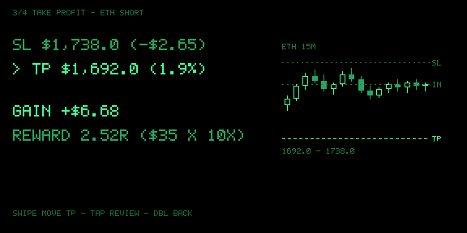
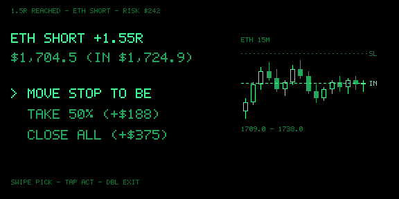

# GlanceDesk for Even G2




**A borderless 1R risk-sized OHLC candlestick HUD for Even G2 smart glasses — lock your exact dollar risk (e.g. `$100`, `$242`, `$850`), slide Stop Loss & Take Profit over live 15m Hyperliquid candlesticks while position size auto-calculates, manage `+1.5R` Break-Even in one tap, and stay synced with Telegram.**

Built for **Heads Up: Even Realities Hackathon (Nov 23 – Nov 29, 2026)**.

- **Tracks Entered (2 + Special Prize):**
  - **Track 01 · Messaging & News:** Telegram Bot API (live alerts, `/risk 242`, `/alert NEAR 4.20`, `/be`, `/half`, `/close`, `/pnl`, 1-tap natural replies)
  - **Track 02 · Crypto & DeFi:** Hyperliquid API (all 150+ live perps, live 15m OHLC candlesticks rendered via `updateImageRawData`, true 1R risk-based position sizing `qty = riskUsd / |entry - SL|`, safe paper-only R-multiple ledger)
  - **Special Prize:** Best Telegram Integration

---

## Real Trader Workflow on Even G2 (Multi-TF Candles -> SL/TP -> 2D Numpad -> Are You Sure?)
1. **Multi-Timeframe OHLC Candlesticks (`1m · 3m · 5m · 15m · 1h · 2h · 4h · 1D`):** Bullish bars render as hollow bright outlines with wicks; bearish bars render as solid filled bodies floating borderlessly over transparent black glass (`borderWidth: 0`). Switch timeframes inline via `Swipe Up/Down` (`Chart TF: 15m` or G2 Menu) — **SL/TP swipe precision automatically scales to the active timeframe** (fine `±0.05%` scalp steps on `1m` up to `±1.25%` swing steps on `1D`).
2. **Structure-First Ticket (`SL` -> `TP` -> 2D Numpad -> Mandatory `Are You Sure?`):**
   - Pick `Short <COIN>` or `Long <COIN>` directly from the active coin's Telegram feed context (coin-locked so an open ETH trade never hijacks a BTC alert).
   - **Step 1/3 (`Place Stop Loss`):** Swipe up/down to place **`SL` directly on the live candle structure** (step sensitivity adapts to `1m..1D`).
   - **Step 2/3 (`Place Take Profit`):** Swipe up/down to place **`TP` on the candles** and see the setup's **`R:R` (`2.51R`)**.
   - **Step 3/3 (`On-Glasses 2D Looping Numpad`):** Enter **any exact dollar risk of any length** (`$35`, `$203`, `$850`) directly on the glasses (`Swipe Down` = next row, `Swipe Up` = next col, `Tap` = pick digit, `Double Tap` = confirm). Position size (`qty = risk / |entry - SL|`) and target gain auto-calculate live.
   - **Review -> Mandatory `Are You Sure?` Confirmation:** Every trade shows exact risk, reward, auto-sized qty, and **`Risking X.X% of balance`** before asking **`Tap AGAIN to confirm`** (fat-finger typos exceeding balance like `$12,500` on `$10,000` are hard-blocked on-lens and server-side).
3. **Explicit Per-Coin Position Management (+1.5R Break-Even & 50% Partial):** Every action names its coin explicitly (`Move ETH SL to BE`, `Take 50% ETH`, `Close ETH 100%`, `Switch to BTC`) so managing multiple open positions is unambiguous.

---

## Real-Life Edge Cases, Resilience & Path to Live Accounts
- **Mandatory Two-Step Trade Confirmation + Per-Trade Account Cap (`$12,500` vs `$125`):**
  - Every valid trade displays **`Risking X.X% of balance — Are you sure?`** after `Tap to execute` and requires a second confirming tap (with a `! HIGH RISK` callout above `5%` of balance).
  - Hard-blocks BOTH typos exceeding available balance (`$12,500` on `$10,000`) AND oversized bets exceeding your configurable per-trade account cap (`maxRiskPct`, default `10%`, adjustable via `/maxrisk 5` in Telegram) — enforced on-lens and server-side.
- **Asymmetric Offline Resilience (BLE / Network Drops):**
  - **Protective actions (`Move SL to BE`, `Take 50%`, `Close 100%`):** Carry an `idempotencyKey`. If connectivity drops mid-stop move, GlanceDesk **never pretends it succeeded**: the eyebrow immediately displays `retrying <COIN> BE` across every view and replays the exact idempotent request every 3 seconds until confirmed — zero silent failures, zero duplicate executions.
  - **New risk-increasing entries:** Fail fast with `OFFLINE · order NOT sent` so a stale entry never fills minutes later at an unintended price.
- **Safe Path From Paper to Real Hyperliquid Accounts:**
  - **Hyperliquid Trade-Only API Agent Wallet:** Zero withdrawal permissions — even a compromised phone or proxy cannot move funds out of the account.
  - **Exchange-Native Reduce-Only SL/TP Orders:** Attached on Hyperliquid's orderbook at entry so the stop still executes on-chain even if glasses, phone, and internet all go offline simultaneously.
  - **Daily Drawdown Circuit Breaker + Phone Biometric Sign-Off:** Hard daily loss cap enforced before signing, plus phone FaceID/fingerprint sign-off for any risk above the user's configured threshold.
- **Daily Users & Monetization:**
  - Built for busy active perp traders (students, engineers, founders, funded-account traders) who already monitor Telegram alpha groups and Hyperliquid, and miss Break-Even moves or clean setups during lectures, meetings, or commutes.
  - Sustainable dual model: affordable **Pro subscription (`$9–$19/mo`)** for multi-account API-wallet execution, custom Telegram alert routing, and journal sync, paired with opt-in **Hyperliquid Builder Code fee share** (`1–3 bps` on live volume).

---

## Hardware & Store QA Compliance
- **Calibrated on Real Even Hub Simulator (`@evenrealities/evenhub-simulator`):** `eyebrow` and `hint` heights tuned to `34px` to eliminate LVGL single-line scrollbars; `220 × 142` OHLC image container strictly within the `288 × 144` hardware cap.
- **Official SDK Validated (`validateEvenHubPageContainer`):** 3 borderless text zones (`textColor: 4` primary / `textColor: 1` whisper metadata) + sequential coalesced `updateImageRawData` for smooth SL/TP sliding + native `menuObject`.
- **Flicker-Free & Safe:** `textContainerUpgrade` in-place refreshes, `CLICK_EVENT (0 -> undefined)` handling, mandatory root `shutDownPageContainer(1)` exit dialog, zero secrets in WebView, strictly paper-only funds.

---

## Quick Start (Reproducible Setup)

**Requirements:** Node.js `>= 20` and a free Telegram bot token from `@BotFather`.

```bash
npm install
cp .env.example .env   # Paste your TELEGRAM_BOT_TOKEN
npm test               # Runs 11 unit, multi-TF, safety-guard & official SDK validation tests
npm run server         # Terminal 1 — Backend proxy (:8787)
npm run dev            # Terminal 2 — Glasses WebView (:5173)
npm run sim            # Terminal 3 — Official Even Hub G2 Simulator
```

*(Build & package `.ehpk`)*
```bash
npm run build
npm run pack:ehpk
```

---

## Money Safety & Prior Work Disclosure
- **Paper Trading Only:** GlanceDesk runs strictly on a simulated `$10,000` paper balance. Zero custody, zero real-money execution, no financial advice.
- **Built During Hackathon:** All source code was written from scratch starting November 23, 2026 during the official build window.

---

## 5 API Feature Requests (For Even Realities, Telegram & Hyperliquid Teams)
1. **Even Hub SDK — Preserve Explicit `0` on `CLICK_EVENT`:** Prevent `OsEventTypeList.CLICK_EVENT` (`0`) from deserializing as `undefined` so tap handlers never silently miss clicks.
2. **Even Hub SDK — Optional Single-Line `noScroll` Flag on Text Containers:** Short single-line headers/footers render an LVGL scrollbar unless extra vertical padding is added; an explicit `scrollable: false` flag would simplify clean HUD layouts.
3. **Even Hub SDK — Native Partial-Region Image Diffing:** When sliding an SL/TP line over a static candlestick background, delta-patching only the moved horizontal row would make interactive chart scrubbing feel instant over BLE.
4. **Telegram Bot API — Scoped Opt-In Recent Group Context:** Allowing assistant bots to fetch the last N messages upon opt-in would remove cold-start empty feeds on wearables.
5. **Hyperliquid Info API — Filtered `assetCtxs` Query:** Supporting `{ type: "assetCtxs", coins: ["BTC", "ETH", "SOL", "NEAR"] }` would reduce wearable proxy payload size by >95%.
